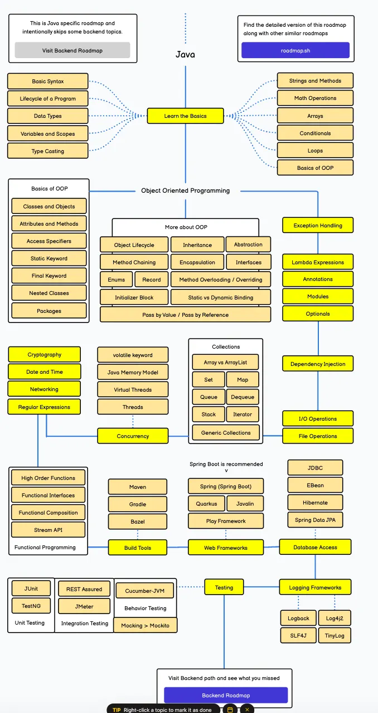

## Java Mülakat Hazırlığı

> Repoya eklenmesi planlanan içerikler ve öneriler için [YAPILACAKLAR.md](YAPILACAKLAR.md) dosyasına bakın.

### Yeni Başlayanlar İçin Konular

### Core Java

- OOP Design
- Exceptions
- Collection API
- Stream API
- Thread
- Generics
- [Yeni Java Özellikleri (Java 9 → 27)](src/main/java/modernjava/YeniJavaOzellikleri.md)

### Ekstra Konular
- SQL
- Git
- Linux
- Docker
- Spring Framework
- Unit Test

### Önerilen Kitaplar

- Code Complete
- Clean Code
- Effective Java
- Head First Servlet and JSP
- Core Java, Volume I:  Fundamentals  | Cay S. Horstmann
- Core Java, Volume II: Fundamentals  | Cay S. Horstmann
- Java: The Complete Reference
- Pratik Agile -> Özcan ACAR
- Design Patterns -> Özcan ACAR
- Pratik Git -> Özcan ACAR
- Pratik Spring Core-> Özcan ACAR

Özcan ACAR'ın kitapları kendi web sitesi üzerinde ücretsizdir.

### Önerilen Eğitimler

Akın KALDIROĞLU'nun aşağıdaki bütün eğitimleri

- Clean Code
- Java ile Nesne Merkezli Programlama
- Spring ile Kurumsal Uygulama Geliştirme: Temeller
- Java ile RESTful Web Servisi Geliştirme: Temeller
- Spring ile Kurumsal Uygulama Geliştirme: AOP
- Design Patterns

### Türkçe Kaynaklar

- www.bilisim.io
- https://medium.com/@cemdrman
- www.javaturk.org

### Java Temel Mülakat Soruları

- https://www.datacamp.com/blog/java-interview-questions
- https://codefinity.com/blog/The-80-Top-Java-Interview-Questions-and-Answers
- https://www.guvi.in/blog/40-java-interview-questions-for-freshers/

### Senior Java Developer İçin
- System Design
- Microservices Architecture
- Cloud (AWS, Azure, GCP)
- Kubernetes
- CI/CD
- Monitoring & Logging
- Security
- Performance Tuning
- Messaging Systems (Kafka, RabbitMQ)
- Event-Driven Architecture
- API Design (REST, GraphQL)
- Database Design & Optimization
- DevOps Practices
- Scalability & High Availability
- Distributed Systems
- Caching Strategies
- Load Balancing
- Networking Basics
- Data Structures & Algorithms
- Design Patterns
- Testing Strategies (Unit, Integration, E2E)
- Code Reviews & Best Practices
- Multi-threading & Concurrency
- Spring Boot & Spring Cloud
- Spring Security
- Spring Batch
- Hibernate & JPA
- NoSQL Databases (MongoDB, Cassandra)
- Search Engines (Elasticsearch)
- Distributed Tracing (Jaeger, Zipkin)
- Distributed Caching (Redis, Memcached)
- Distributed Transactions

