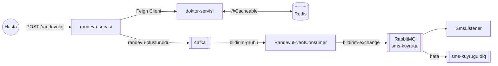

## Hastane Randevu Sistemi - Örnek Proje

Mülakatlarda Spring Boot, Kafka, Redis, RabbitMQ ve Feign Client hakkında soru geldiğinde "projede nerede
kullandın?" sorusu da arkasından geliyor. Bu proje bu teknolojilerin bir arada nasıl kullanıldığını görmek için
hazırlandı. Senaryo `question2` klasöründeki hastane otomasyonu sorusundan geliyor: sadece operatör doktorlar
ameliyata girebilir.

### Akış



1. Hasta `randevu-servisi`'ne randevu isteği gönderir.
2. `randevu-servisi` doktor bilgisini **Feign Client** ile `doktor-servisi`'nden alır.
3. `doktor-servisi` doktor bilgisini **Redis**'te cache'ler, ikinci istekte veritabanına gitmez.
4. Ameliyat randevusu isteniyorsa doktorun operatör olup olmadığı kontrol edilir.
5. Randevu kaydedilir, transaction commit olduktan sonra **Kafka**'ya `randevu-olusturuldu` event'i gönderilir.
6. Kafka consumer event'i alır ve **RabbitMQ**'ya SMS gönderme görevi bırakır.
7. `SmsListener` mesajı işler. 3 denemede de işlenemeyen mesaj dead letter kuyruğuna gider.

Burada neden hem Kafka hem RabbitMQ kullandığımızı soracak olursak; Kafka'daki event "randevu oluşturuldu"
bilgisini tutuyor ve istatistik, faturalama gibi başka servisler de aynı event'i kendi consumer group'larıyla
okuyabilir. RabbitMQ'daki mesaj ise "bu SMS'i gönder" görevi; bir kere işlenip kuyruktan silinmesini istiyoruz.

### Teknolojiler

| | |
|---|---|
| Java | 21 (virtual thread açık) |
| Spring Boot | 4.1.2 |
| Spring Cloud | 2025.1.4 (OpenFeign) |
| Veritabanı | H2 (bellekte) |
| Mesajlaşma | Apache Kafka 4.0, RabbitMQ 4 |
| Cache | Redis 7.4 |
| Test | JUnit 5, MockMvcTester, Embedded Kafka, Testcontainers |

### Nerede Ne Var?

| Konu | Dosya |
|---|---|
| Redis cache ayarları (TTL, JSON serializer) | [RedisCacheConfig.java](doktor-servisi/src/main/java/com/cemdrman/doktor/RedisCacheConfig.java) |
| `@Cacheable`, `@CacheEvict` | [DoktorService.java](doktor-servisi/src/main/java/com/cemdrman/doktor/DoktorService.java) |
| Feign Client, ErrorDecoder | [client](randevu-servisi/src/main/java/com/cemdrman/randevu/client) |
| Kafka topic ve hata yönetimi (DLT) | [KafkaConfig.java](randevu-servisi/src/main/java/com/cemdrman/randevu/mesajlasma/KafkaConfig.java) |
| Kafka producer, `@TransactionalEventListener` | [RandevuEventProducer.java](randevu-servisi/src/main/java/com/cemdrman/randevu/mesajlasma/RandevuEventProducer.java) |
| Kafka consumer | [RandevuEventConsumer.java](randevu-servisi/src/main/java/com/cemdrman/randevu/mesajlasma/RandevuEventConsumer.java) |
| RabbitMQ exchange, queue, DLQ | [RabbitConfig.java](randevu-servisi/src/main/java/com/cemdrman/randevu/mesajlasma/RabbitConfig.java) |
| RabbitMQ listener | [SmsListener.java](randevu-servisi/src/main/java/com/cemdrman/randevu/mesajlasma/SmsListener.java) |
| Validation, ProblemDetail | [RandevuIstegi.java](randevu-servisi/src/main/java/com/cemdrman/randevu/randevu/RandevuIstegi.java), [GlobalExceptionHandler.java](randevu-servisi/src/main/java/com/cemdrman/randevu/GlobalExceptionHandler.java) |

### Çalıştırma

Kafka, Redis ve RabbitMQ'yu Docker ile ayağa kaldırıyoruz:

```bash
docker compose up -d
```

İki servisi ayrı terminallerde çalıştırıyoruz:

```bash
./mvnw -pl doktor-servisi spring-boot:run
```

```bash
./mvnw -pl randevu-servisi spring-boot:run
```

Randevu oluşturmak için:

```bash
curl -i -X POST localhost:8080/randevular -H 'Content-Type: application/json' -d '{"hastaAdi":"Ali Veli","hastaTelefon":"5550000000","doktorId":1,"tarih":"2030-01-15T10:00:00","tip":"AMELIYAT"}'
```

Cevap:

```
HTTP/1.1 201
Location: /randevular/1
{"id":1,"hastaAdi":"Ali Veli","doktorAdi":"Ayşe Yılmaz","tarih":"2030-01-15T10:00:00","tip":"AMELIYAT"}
```

`randevu-servisi` loglarında sırasıyla Feign çağrısını, Kafka'ya gönderilen event'i ve SMS'in gönderildiğini
görebiliriz. Operatör olmayan doktor için (`"doktorId":2`) ameliyat randevusu istersek `422` döner.

RabbitMQ arayüzüne http://localhost:15672 adresinden `guest / guest` ile girip kuyrukları görebiliriz. Redis'teki
cache'i görmek için:

```bash
docker compose exec redis redis-cli --raw GET doktorlar::1
```

### Testler

```bash
./mvnw test
```

- `DoktorServiceCacheTest`: Aynı doktor iki kez istendiğinde veritabanına bir kez gidildiğini test eder.
- `DoktorClientTest`: Feign Client'ı JDK'nın `HttpServer`'ı ile ayağa kaldırılan sahte bir servise karşı test eder.
- `RandevuAkisTest`: Gömülü Kafka ile REST → Kafka → RabbitMQ akışını test eder.
- `RandevuEntegrasyonTest`: Testcontainers ile gerçek Kafka ve RabbitMQ üzerinde uçtan uca test eder.
  Docker çalışmıyorsa bu test atlanır.

### Bilerek Basit Bırakılanlar

- Randevu kaydedildikten sonra Kafka'ya gönderim başarısız olursa event kaybolur. Gerçek bir projede bunun için
  [Transactional Outbox Pattern](https://bilisim.io/2024/12/15/spring-boot-ile-adim-adim-transactional-outbox-pattern/)
  kullanılmalı.
- Feign çağrısında circuit breaker yok. Resilience4j ile eklenebilir.
- Güvenlik (Spring Security) eklenmedi.
